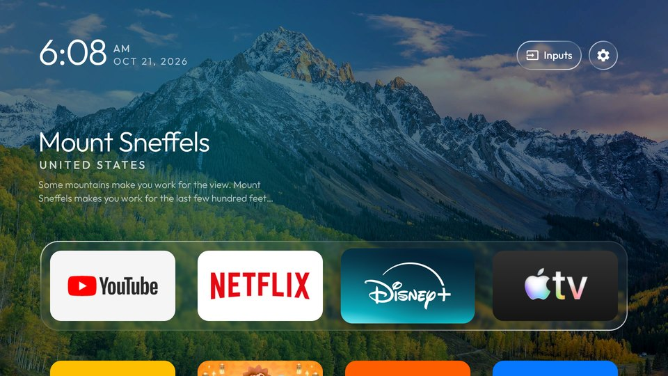
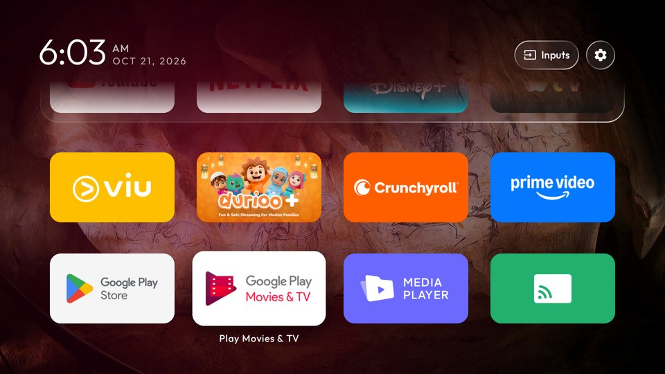
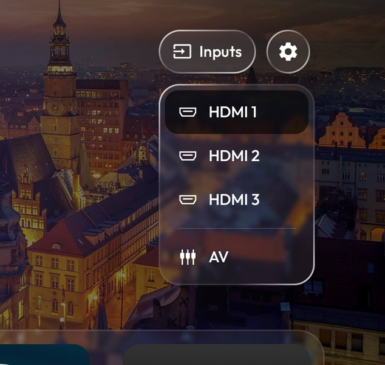
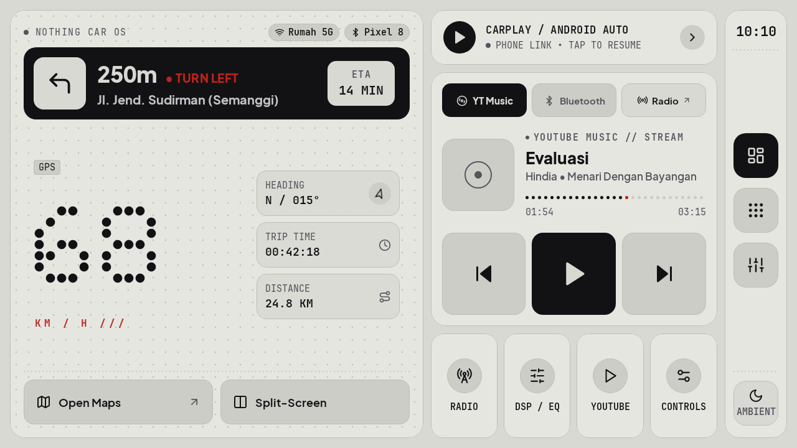
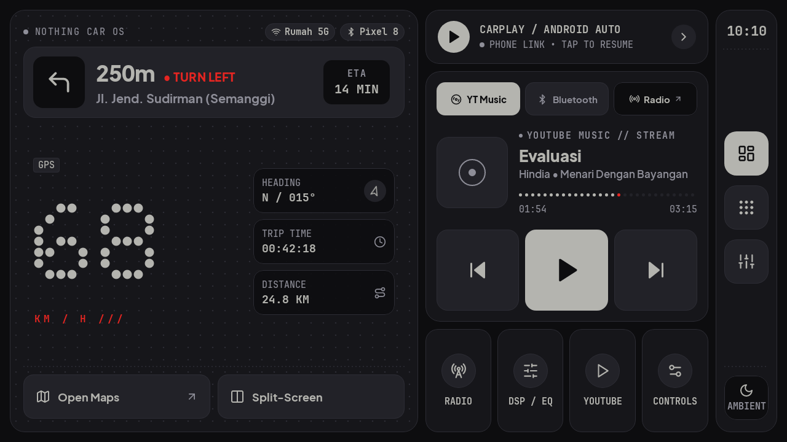
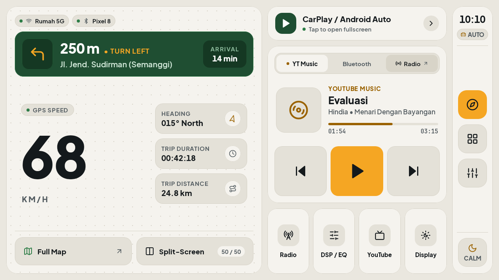
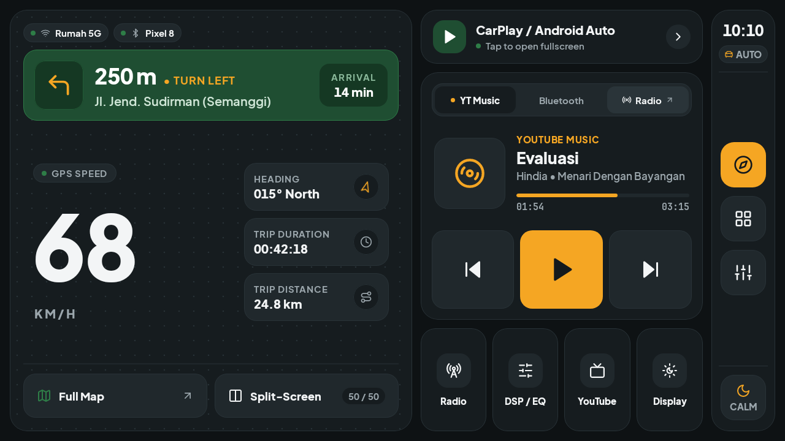
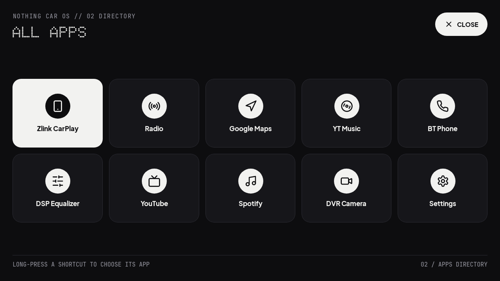
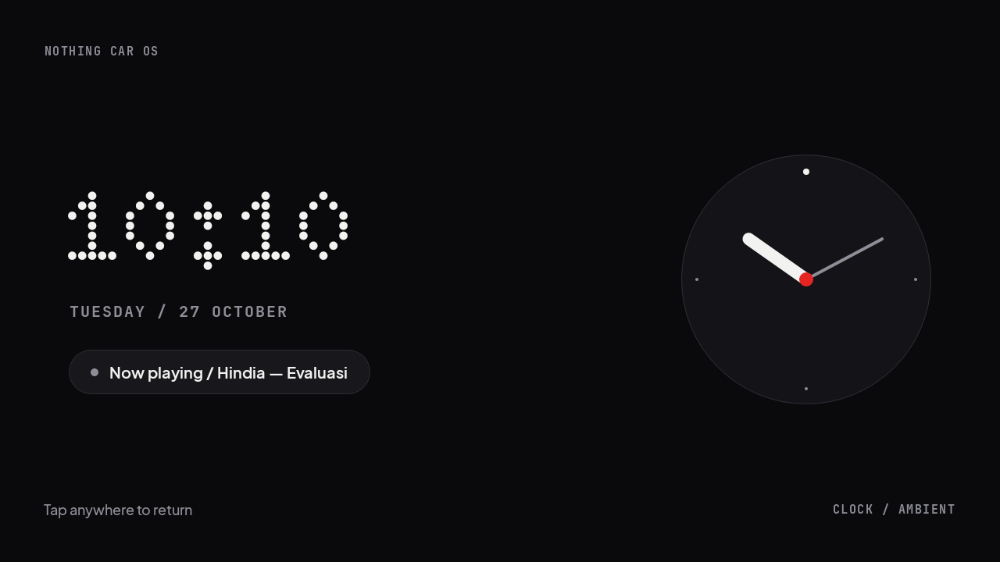

# Home OS

Dua launcher Android untuk perangkat di rumah: **Glass TV** untuk Android TV, dan **Nothing Car OS** untuk
head unit mobil. Proyek hobi, dipakai sendiri; tidak resmi dan tidak berafiliasi dengan merek mana pun.

## Glass TV (`launcher/app`)

Home screen ringan berlapis kaca untuk Android TV / Google TV, plus debloat lewat Wi-Fi tanpa root (semua bisa
dikembalikan). Fork dari [glass-tv-home](https://github.com/aqmangge/glass-tv-home), disesuaikan untuk rumah
di Indonesia:

- Tampilan berbahasa Indonesia, tanggal dan jam Indonesia.
- Cuaca dan kualitas udara dari Open-Meteo, dengan pilihan 31 kota (default Jakarta).
- Jam selalu benar walau firmware TV mengambil jam dari siaran: waktu diambil dari NTP, zona Asia/Jakarta.
- Tanpa jadwal solat, ayat harian, tombol mic, dan updater otomatis dari upstream.
- Daftar debloat untuk TCL UnionTV di [`examples/`](examples/).

| | |
|---|---|
|  |  |
|  |  |

Langkah lengkap (cek model TV, backup, debloat, install, tema) ada di [AGENTS.md](AGENTS.md) dan
[docs/CLEANYOURTV-README.md](docs/CLEANYOURTV-README.md). Singkatnya:

```bash
python3 -m venv tools/venv && tools/venv/bin/pip install -r tools/requirements.txt
export TV_HOST=192.168.1.50                       # IP TV
tools/disable.sh examples/<tv-kamu>/debloat.txt   # debloat
launcher/build-and-install.sh                     # build launcher dan jadikan Home
```

TV yang didukung: Android TV / Google TV, Android 8 ke atas ([docs/DEVICES.md](docs/DEVICES.md)). LG (webOS)
dan Samsung (Tizen) tidak bisa menjalankan launcher Android.

## Nothing Car OS (`launcher/headunit`)

Home screen untuk head unit Android aftermarket (1280 x 720, setir kanan), Kotlin + Jetpack Compose, dengan
dua skin: **Nothing** (matte, dot-matrix, mode siang/malam ikut lampu mobil) dan **Rivian**. Isinya
speedometer dan trip dari GPS, navigasi Google Maps, media YT Music dan Bluetooth, cuaca, serta dock
pengemudi di kanan. Diuji di unit NWD (Allwinner K2501, Android 10), termasuk musik Bluetooth lewat modul
NWD-nya sendiri.

| | |
|---|---|
|  |  |
| *Nothing, siang* | *Nothing, malam (lampu mobil menyala)* |
|  |  |
| *Rivian, siang* | *Rivian, malam* |
|  |  |
| *Semua aplikasi* | *Ambient* |

Cara install, debloat, dan catatan firmware NWD ada di [launcher/headunit/README.md](launcher/headunit/README.md)
dan [launcher/headunit/debloat-nwd-k2501.txt](launcher/headunit/debloat-nwd-k2501.txt).

## Kredit dan lisensi

- Berbasis [glass-tv-home](https://github.com/aqmangge/glass-tv-home) dan
  [CleanYourTV](https://github.com/Gathin23/cleanyourtv) © 2026 Gathin, lisensi MIT ([LICENSE](LICENSE)).
- Font: Outfit (Glass TV); Doto, Plus Jakarta Sans, JetBrains Mono (head unit). Semua SIL Open Font License,
  lihat `launcher/FONT-LICENSE-OFL.txt` dan `launcher/headunit/FONT-LICENSES.txt`.
- Ikon head unit dari [Lucide](https://lucide.dev) (ISC, `launcher/headunit/ICONS-LICENSE.txt`); ikon Inputs
  dari Material Icons (Apache 2.0).
- Foto tempat dan keterangannya adalah gambar harian Bing (Microsoft), diambil langsung oleh TV.
- "Nothing" dan "Rivian" adalah merek dagang pemiliknya; di sini hanya nama gaya tampilan.
