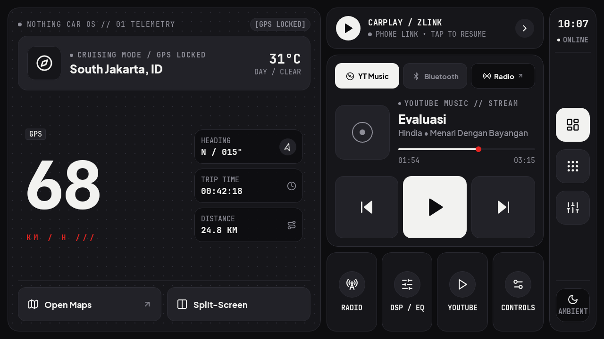

# Nothing Car OS: head unit launcher

Home screen for an aftermarket Android head unit (1280 x 720 landscape, right-hand drive), in the
Nothing OS matte style: telemetry and navigation on the left, media in the middle, the driver dock on
the right. Kotlin + Jetpack Compose, one activity, no blur, no shadows.

| | |
|---|---|
|  |  |
|  |  |

## Install

USB debugging on, the unit on the same Wi-Fi (or a USB cable), then from `launcher/`:

```bash
HU_HOST=192.168.1.60 headunit/setup_adb.sh
```

It builds the APK, installs it, grants location and notification access, and makes it Home. Nothing
is disabled; `headunit/setup_adb.sh --restore` puts the unit's own launcher back as Home.

## What drives what

- **Turn-by-turn card**: Google Maps' navigation notification (`CarNotificationListener`, parsed in
  `NavParser.kt`). No navigation: the cruising header with place and weather (Open-Meteo).
- **Media hub**: the active media session. The Bluetooth tab follows the unit's Bluetooth audio,
  the YT Music tab follows YT Music or any other player.
- **Speed, heading, trip**: GPS (`TelemetryManager`). The trip resets after 30 minutes without a fix
  (parked), or hold TRIP TIME / DISTANCE.
- **Radio, DSP, BT Phone, DVR, Zlink**: the unit's own apps. Each button tries the usual package
  names (8227L HCN/AutoChips names first), then app names; **hold any of them to pick the right app**
  (saved). The first quick tile is yours: hold it and it becomes any app.
- **Two interfaces**: Nothing (matte, monochrome, red accent) and Rivian (warm sand by day, forest
  slate by night, yellow and green accents). Pick one in Quick Settings (Nothing) or Display (Rivian);
  only the chosen one is drawn, and Rivian adds about 36 KB to the APK.
- **Day / Night / Auto**: Auto follows the car's headlights, read from the ILL wire's effect on the
  screen brightness setting or night uiMode, and sunset (Open-Meteo `is_day`, else 18:00-06:00).
  The headlight threshold is a slider next to the live backlight reading: set it once per unit.
- **Scaling**: the design is laid out in its 1280 x 720 pixels; other screens get the same layout
  scaled, letterboxed (1024 x 600 at 80%).

## Not yet checked on a real unit

The screens are rendered on the JVM with Paparazzi (`./gradlew :headunit:recordPaparazziDebug`), and
the parsers have unit tests, but nothing has run on a head unit yet:

- Google Maps' notification layout for your Maps version and language.
- Split-Screen uses `FLAG_ACTIVITY_LAUNCH_ADJACENT`; only firmware with split-screen honours it.
- The radio/DSP/DVR package names come from common units; hold the button if one is wrong.
- Bluetooth audio on AutoChips units only plays while their BT Music screen is the source; with no
  session, play on the Bluetooth tab opens it.
- Trip distance while another app is in front (Android may throttle GPS for a background app).
- Whether this unit's headlights show up at all: many MCUs dim the backlight in hardware, where
  Android sees neither the brightness setting nor uiMode change. Then Auto goes by sunset only.

Fonts: Doto (round-dot instance), Plus Jakarta Sans, JetBrains Mono (SIL OFL, `FONT-LICENSES.txt`). Icons: Lucide
(ISC, `ICONS-LICENSE.txt`).
